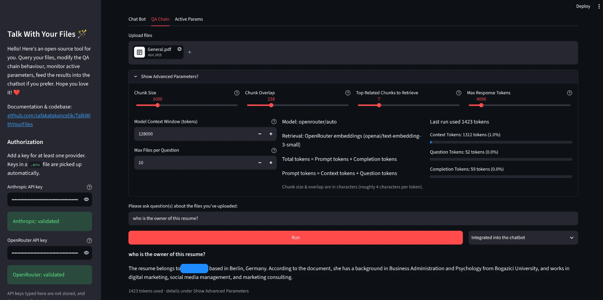
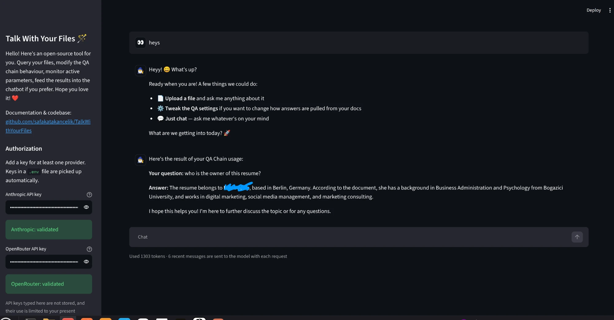
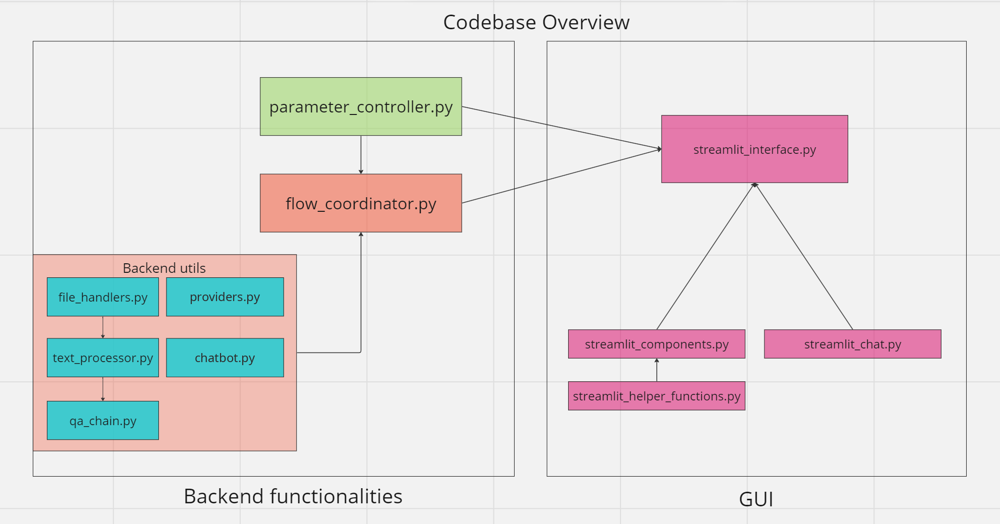

# Talk With Your Files (LLM(Langchain), GUI(Streamlit))

I built this app before OpenAI shipped file uploads with GPT-4: upload your files and ask questions about them.
This version is a tribute to that original, using the exact same layout. It works and solves real problems, and I'm thinking about how to take it to the next step.
(The original 2023 version: [`v1.0.0`](https://github.com/safakatakancelik/TalkWithYourFiles/releases/tag/v1.0.0).)

## Description
Talk-With-Your-Files is an open source GUI (Graphical User Interface) application powered by LLMs (Large Language Models). Simply load your documents (PDF, DOCX, TXT, CSV) and then ask your questions about them. Choose to use dynamic processing parameters or default settings. + you can ask your questions standalone or integrate them into a chatbot conversation.

Question answering chain:

Chatbot integration:

### Functionalities

- Question your files (PDF, DOCX, CSV, TXT) and choose to integrate results into the chatbot.
- Conversation with an LLM.
- Tweak the QA chain behaviour with dynamic parameters & see what the context window was spent on.
- Monitor the active parameters.

Current frameworks in use:
- Langchain - Handle LLM integration & processing texts.
- Streamlit - Prepare the GUI

### Models
- **Anthropic** (Claude) or **OpenRouter** (GPT, Gemini, Llama, Claude and many more). Pick one in the sidebar and type any model name.
- With an OpenRouter key, related chunks are found with embeddings. With only an Anthropic key, keyword search (BM25) is used, since Anthropic has no embeddings API.

## Installation

1. Clone the repository: `git clone https://github.com/safakatakancelik/TalkWithYourFiles.git`
2. Install the required dependencies: `pip install -r requirements.txt` (Python 3.10+, ideally in a virtual environment)
3. Optional: copy `.env.example` to `.env` and add your API key(s).

OR
1. Build & run with Docker: `docker build -t talkwithyourfiles .` then `docker run -p 8501:8501 --env-file .env talkwithyourfiles`

## Usage
1. Open the TalkWithYourFiles subdirectory: `cd TalkWithYourFiles`
2. Run the application: `streamlit run streamlit_interface.py`
3. Wait for the application to run on your browser.
4. Add your API key on the sidebar (or use a `.env` file). Keys typed in the sidebar are not stored.
5. Start getting answers to your questions!

## Process Diagrams

## Tips
1. Check individual modules for further documentation.
2. The model can be changed on the GUI, or with `ANTHROPIC_MODEL` / `OPENROUTER_MODEL` in `.env`.
3. New providers can be added in `backend_utils/providers.py`.
4. New file types can be supported by adding a handler to `backend_utils/file_handlers.py`.
5. To use another GUI framework, import `FlowCoordinator` from `flow_coordinator.py` and call `run(files, question)`. It doesn't depend on Streamlit.

## Contributing
Contributions are welcome! If you find any issues or have suggestions for improvements, please create a new issue or submit a pull request.
Run the tests with `pip install -r requirements-dev.txt && pytest`.

## License
This project is licensed under the [MIT License](LICENSE).
