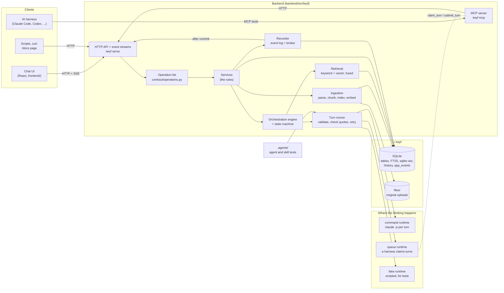
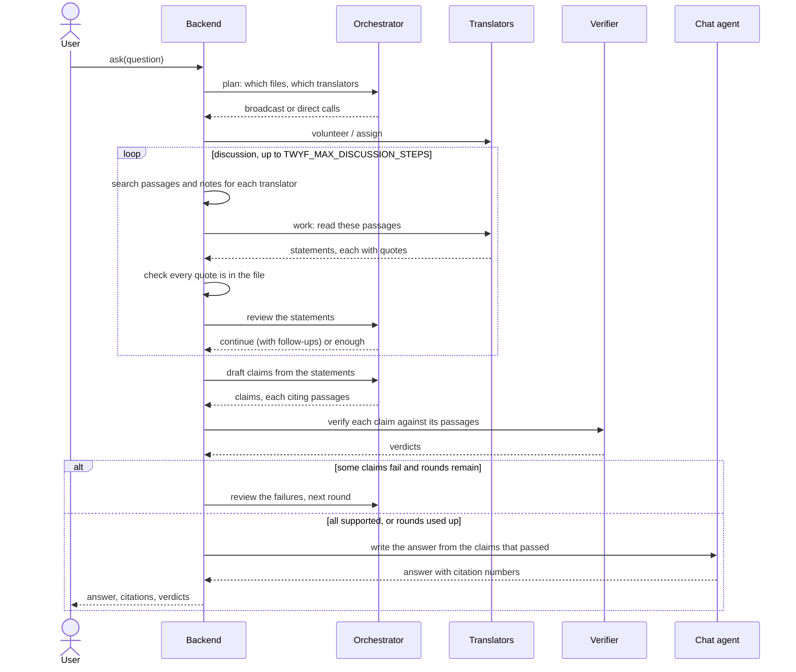

# Talk With Your Files

## Contents

- [Start](#start)
  - [Three ways to use it](#three-ways-to-use-it)
  - [Options](#options)
  - [Without the start script](#without-the-start-script)
- [Use the app from an agent harness (MCP)](#use-the-app-from-an-agent-harness-mcp)
- [Let a harness do the agent work (queue runtime)](#let-a-harness-do-the-agent-work-queue-runtime)
- [How it works](#how-it-works)
- [Documentation](#documentation)
- [License](#license)

Have a conversation with your files. You add files to a workspace and ask questions about them in a chat. A huddle of agents works out the answer together, a verifier checks every claim against the exact passages it cites, and only verified claims reach you, each with its citations.

Revision 2 has a Python backend (`backend/`), a React UI (`frontend/`) and an MCP server, so any agent harness that speaks MCP (Claude Code, Codex, opencode, ...) can use the app and can also do its agent work.

## Start

You need [uv](https://docs.astral.sh/uv/) (it brings Python 3.13), [Node.js](https://nodejs.org/) with npm, and [Claude Code](https://docs.claude.com/en/docs/claude-code) for the agents. `./start.sh` at the repository root starts everything a way of use needs, installs the packages on its first run, and stops it all on Ctrl+C. Data is kept in `~/.twyf`.

The backend never calls a model itself. With `./start.sh`, each agent turn runs Claude Code headless (`claude -p`) once, with no tools, no MCP servers and no saved session: it reads its input and returns JSON, which the backend validates, checks quote by quote and verifies.

### Three ways to use it

**1. The app, as an end user.** The chat UI with the agents behind it. The agents run on one of two accounts.

`./start.sh` picks the account from one environment variable, `ANTHROPIC_API_KEY`, and says which it picked in its first line.

With your Claude subscription (Pro or Max). Sign in to Claude Code once with `claude`, make sure no API key is set, then start:

```bash
unset ANTHROPIC_API_KEY
./start.sh
```

It prints `Agents: Claude Code, model sonnet, on your Claude Code login.` The turns count against your plan's usage limits; there is no separate bill.

With an Anthropic API key, billed per token. The variable must be named exactly `ANTHROPIC_API_KEY` (not `ANTHROPIC_KEY`) and must be exported, or set on the same line as the command:

```bash
export ANTHROPIC_API_KEY=sk-ant-api03-...
./start.sh
```

```bash
ANTHROPIC_API_KEY=sk-ant-api03-... ./start.sh
```

In fish: `set -x ANTHROPIC_API_KEY sk-ant-api03-...`. It prints `Agents: Claude Code, model sonnet, billed to ANTHROPIC_API_KEY.` If it says `on your Claude Code login` instead, the key did not reach the script: `env | grep ANTHROPIC_API_KEY` prints nothing in that shell. A wrong or unfunded key shows its reason, such as `Invalid API key`, as the error of the question in the chat.

Either way, `--model` picks the model (`sonnet` by default). The UI opens on `http://localhost:5173`, the API runs on `http://127.0.0.1:8321`. Every question goes through the huddle and the verifier. If either port is taken (`Port 5173 is already in use`), stop what holds it, such as another `npm run dev`, or pick other ports with `TWYF_UI_PORT` and `TWYF_PORT`.

**2. The backend alone.** The API without the UI, for scripts or your own client: workspaces, files, agents, notes, sessions, questions and the context map.

```bash
./start.sh --backend-only
```

Every operation can be tried at `http://127.0.0.1:8321/docs`. Asking still runs the agents; everything else needs no model.

**3. From an AI harness, through MCP.** Claude Code, Codex, opencode or any MCP client uses the app's tools next to its own. Start the backend with way 1 or 2, then connect the harness (see [Use the app from an agent harness](#use-the-app-from-an-agent-harness-mcp)). What is enforced depends on the tool the harness calls:

| The harness calls | What runs | Verified? |
|---|---|---|
| `ask` | The whole orchestration: translators, discussion, verifier. The harness gets the verified answer with its citations | Yes |
| `ask_translator` | One translator answers about its file | Cited, not verified |
| Reads (`get_file_text`, `list_notes`, `get_context_map`, ...) | Nothing: the harness gets the raw text and data and reasons on its own | No |

So the harness can combine both: its own search and reading where it is enough, and `ask` where an answer has to be checked. Only `ask` enforces the orchestration.

A harness can also be the agents' model: with `./start.sh --queue` no agents start, and a harness session does every turn (see [queue runtime](#let-a-harness-do-the-agent-work-queue-runtime)). The orchestration and the verification stay in the backend either way.

### Options

| Option | Effect |
|---|---|
| `--model NAME` | The model for every turn: `sonnet` (default), `opus`, `haiku`, or a full name. `TWYF_MODEL` does the same |
| `ANTHROPIC_API_KEY` | Turns are billed to this key (Claude Code's `--bare` mode, which also skips your hooks, plugins and CLAUDE.md). Without it they run on your Claude Code login and count against your plan |
| `--backend-only` | No UI |
| `--queue` | No agents started: a harness does the turns |
| `--basic` | Without the rich extra: basic parsers and keyword search only, and a much smaller install |
| `--no-browser` | Does not open the browser |
| `TWYF_PORT`, `TWYF_UI_PORT` | Other ports for the API and the UI |
| `TWYF_DATA_DIR` | Another data folder |

Every other setting is an environment variable with the prefix `TWYF_`; the table is in [01-architecture.md](docs/development/revision-2-backend/01-architecture.md) section 6. Running on your own Claude Code login is meant for your own use; anyone you share the app with should use their own API key.

`./start.sh` installs the `rich` extra unless `--basic` is given: Docling (layout-aware PDF and Word reading, OCR for scans and images) and fastembed (search by meaning, so search is hybrid: keyword and vectors). The first run downloads about 450 MB of packages, then about 720 MB of models from Hugging Face as files are added. Files added before, and files that gave no text, are embedded and parsed again at the next start.

### Without the start script

| What | How |
|---|---|
| The UI alone, on its built-in mock | `cd frontend && npm install && npm run dev`, then press "Run demo". No backend is needed |
| The backend by hand | `cd backend && uv run twyf serve`. It uses the `queue` runtime unless `TWYF_RUNTIME=command` (the command is `TWYF_COMMAND`, a JSON list) |
| The scripted demo on the real backend | `backend/scripts/run_demo_server.sh`, then ask the demo question in workspace `demo` ([10-demo-scenario.md](docs/development/revision-2-backend/10-demo-scenario.md)), or run `TWYF_TEST_BACKEND_URL=http://127.0.0.1:8321 npm test` from `frontend/` |

"Run demo" in the UI always plays the mock's scripted story, even with a backend connected.

## Use the app from an agent harness (MCP)

`twyf mcp` is an MCP server that turns every API operation into a tool. It needs the backend running.

- **Claude Code**: open the repository root. `.mcp.json` registers the server as `twyf`.
- **Other harnesses**: run `uv run --directory backend twyf mcp` as a stdio MCP server, or `uv run twyf mcp --http` for Streamable HTTP on `http://127.0.0.1:8322/mcp`. Set `TWYF_API_URL` if the API is not on `http://127.0.0.1:8321`.

The tools cover workspaces, files (`upload_file` takes a `path` or base64 content), agents, notes, sessions and questions. The `ask_files` prompt shows how to ask and present a cited answer.

## Let a harness do the agent work (queue runtime)

With `./start.sh --queue` every agent turn waits in the database until a worker claims it:

1. In a harness connected through MCP, use the `work_agent_queue` prompt (argument `worker_name`). It loops: `claim_turn`, do the turn as instructed, `submit_turn`.
2. Ask from the UI, or with `ask(..., wait: false)` from the MCP tools, and read the events with `get_question_events`.

One harness session does every turn, so its context keeps growing. Run it with file, shell and network tools switched off: its job needs none of them, and that keeps an instruction hidden in a file from reaching anything.

## How it works

The two main diagrams from [docs/how-it-works.md](docs/how-it-works.md), which also covers adding a file, search, the question's states, what is enforced, and which parts run in each way of use.

**The parts.** The UI, scripts and harnesses reach one backend. The backend never calls a model itself: each agent turn goes to a runtime, and every output is validated and its quotes checked against the files.



**Asking a question.** Translators read passages and quote them, the orchestrator decides when there is enough, and only claims the verifier supports reach the answer.



## Documentation

- How the parts connect, with diagrams: [docs/how-it-works.md](docs/how-it-works.md)
- Backend plan and design: [docs/development/revision-2-backend/](docs/development/revision-2-backend/)
- UI design: [docs/development/revision-2-initialization/design.md](docs/development/revision-2-initialization/design.md)
- Backend commands and tests: [backend/README.md](backend/README.md)
- Every dependency and why it is needed: [docs/dependencies.md](docs/dependencies.md)
- Previous version: [docs/versions/revision-1.md](docs/versions/revision-1.md)

## License
[MIT](LICENSE)
