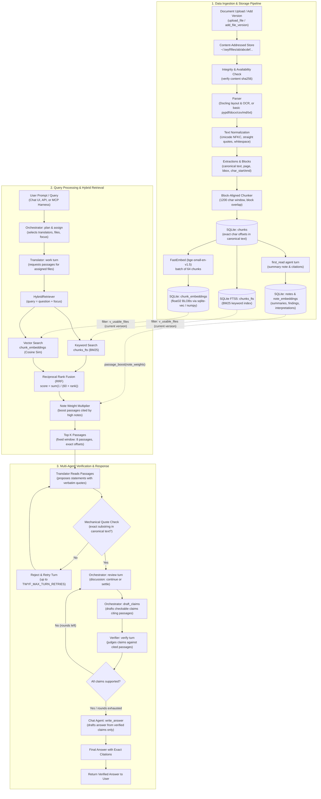
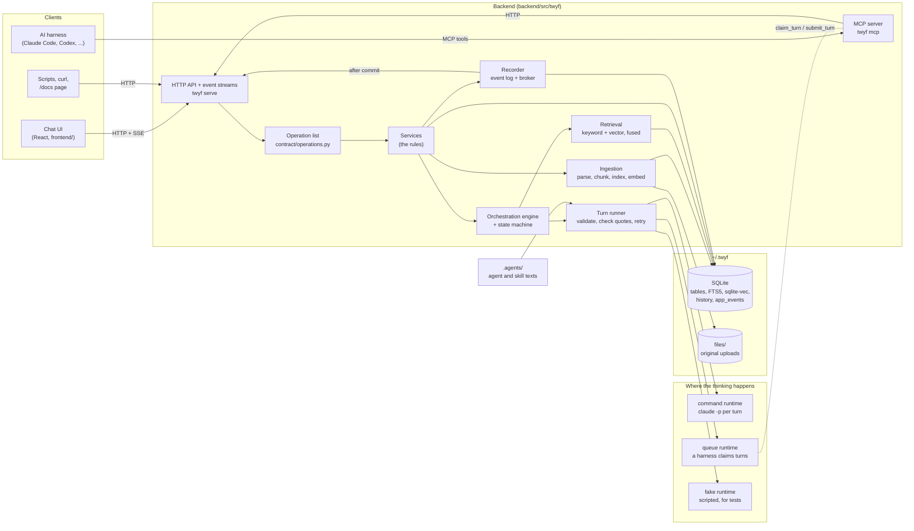
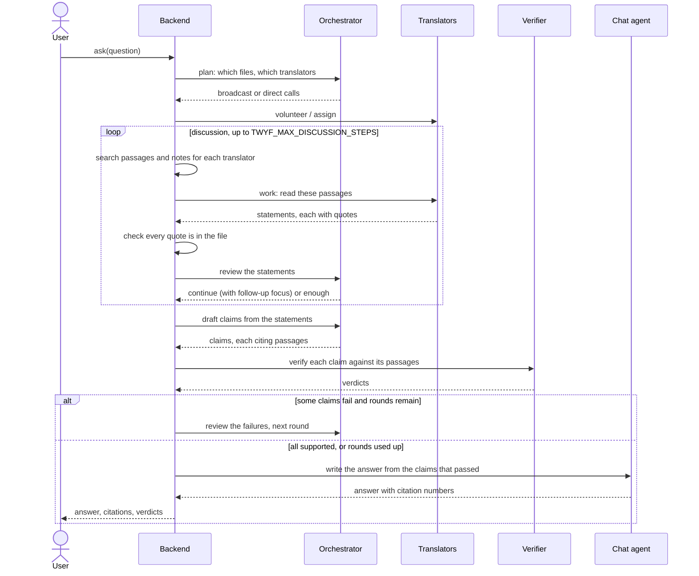
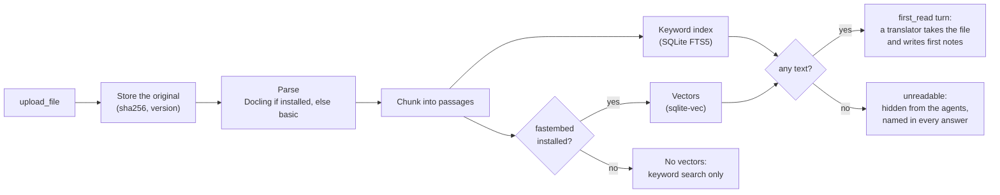
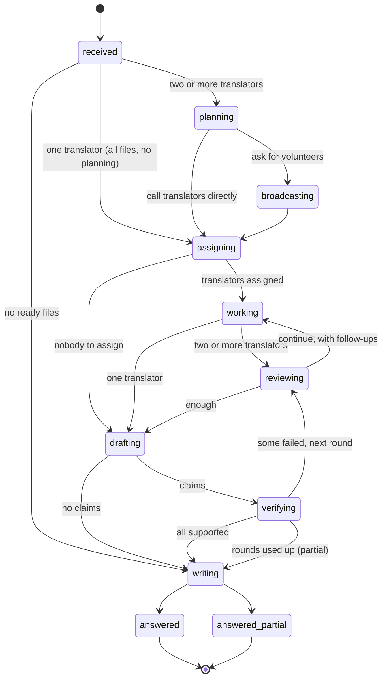
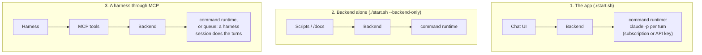

# Architecture & Workflow Diagrams

This directory is the single source of truth for all system architecture, workflow, and sequence diagrams for **Talk With Your Files**.

## Table of Diagrams

1. [End-to-End Pipeline (Ingestion, Search, Agents, Verification)](#1-end-to-end-pipeline)
2. [System Components & Architecture](#2-system-components--architecture)
3. [Question Orchestration Sequence](#3-question-orchestration-sequence)
4. [File Ingestion Flow](#4-file-ingestion-flow)
5. [Question State Machine](#5-question-state-machine)
6. [Runtime Execution Modes](#6-runtime-execution-modes)

---

## 1. End-to-End Pipeline

How documents are ingested, stored, indexed, retrieved, and answered through the multi-agent huddle and verification loop:

---

## 2. System Components & Architecture

The relationship between client interfaces, backend services, local storage, agent runtimes, and instructions:

---

## 3. Question Orchestration Sequence

The sequence of interactions during a question. This is the full huddle, used when the workspace has two or more translators. With exactly one translator, the plan, volunteer/assign and review turns are skipped: every ready file goes to that translator, which works once, and the question goes straight to drafting claims (4 turns: work, draft_claims, verify, write_answer).

---

## 4. File Ingestion Flow

The detailed pipeline run for every uploaded file version:

---

## 5. Question State Machine

The states of a question during orchestration (`orchestration/machine.py`):

---

## 6. Runtime Execution Modes

The three ways to run agent turns:

